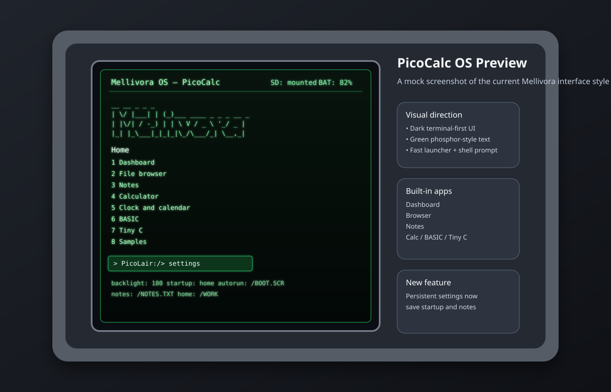
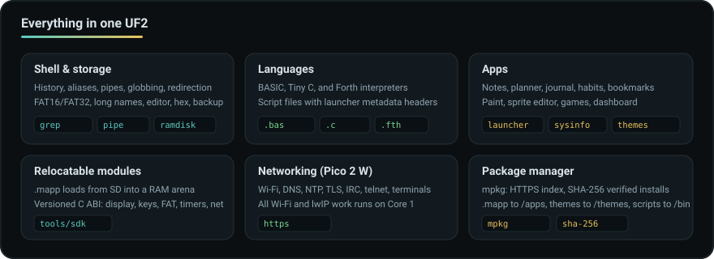
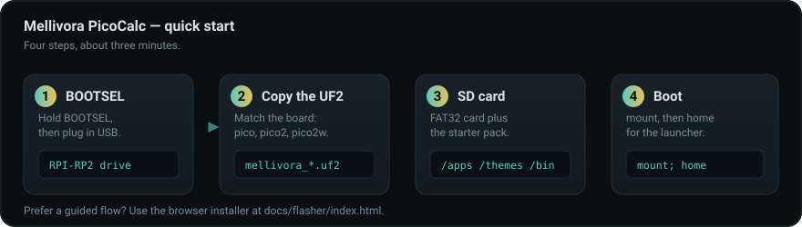

# Mellivora PicoCalc

Mellivora PicoCalc is a compact, keyboard-driven firmware environment for the
Clockwork PicoCalc. It runs on the Raspberry Pi Pico (RP2040), Pico 2
(RP2350), and Pico 2 W (RP2350 with CYW43439 Wi-Fi).



A shell, FAT-backed microSD storage, productivity apps, text and file
utilities, three programming environments, creative tools, games, a hardware
workbench, and a verified package manager — in a single UF2 image.

## Feature highlights



| | |
| --- | --- |
| **Shell** | History, aliases, variables, tab completion, chaining, redirection, pipelines, wildcards, scripts, built-in help |
| **Storage** | FAT16/FAT32 with VFAT long names, browsing, editing, hex inspection, recursive operations, RAM disk, verified backups |
| **Languages** | BASIC, Tiny C subset, and Forth, each runnable from the shell, a script file, or the launcher |
| **Apps** | Notes, todo, planner, journal, habits, bookmarks, paint, sprite editor, games, dashboard, launcher |
| **Modules** | Relocatable `.mapp` binaries loaded from the SD card into a RAM arena with a versioned C ABI — no reflash |
| **Networking** | Wi-Fi, DNS, NTP, HTTP, certificate-verified HTTPS, IRC, and telnet (Pico 2 W) |
| **Packages** | `mpkg` installs `.mapp` modules, themes, and scripts after checking a SHA-256 digest (Pico 2 W) |
| **Workbench** | Full-screen VT100 terminal, `i2cdetect`, GPIO/PWM control, and XMODEM/YMODEM file transfer |
| **Diagnostics** | Live `sysinfo` view of estimated core load, heap fragmentation, SD throughput, and battery state |

Wi-Fi features exist only in the Pico 2 W firmware. Saved Wi-Fi credentials
are readable text on the card; protect it accordingly.

## Quick start



### 1. Flash

Open the **[browser installer](docs/flasher/index.html)** for a guided flow:
it validates the UF2 family, shows the SHA-256 digest, copies the file to a
mounted `RPI-RP2` drive in Chromium browsers, and opens a serial console.

Or do it by hand:

| Board | Firmware image |
| --- | --- |
| Pico (RP2040) | [`firmware/mellivora_v2.5.0_pico.uf2`](firmware/mellivora_v2.5.0_pico.uf2) |
| Pico 2 (RP2350) | [`firmware/mellivora_v2.5.0_pico2.uf2`](firmware/mellivora_v2.5.0_pico2.uf2) |
| Pico 2 W (RP2350 + Wi-Fi) | [`firmware/mellivora_v2.5.0_pico2w.uf2`](firmware/mellivora_v2.5.0_pico2w.uf2) |

1. Disconnect the PicoCalc from USB.
2. Hold **BOOTSEL** while reconnecting the USB cable.
3. Release **BOOTSEL** when the `RPI-RP2` drive appears.
4. Copy the matching UF2 to the drive and wait for the reboot.

Newer images are attached to
[GitHub Releases](https://github.com/James-HoneyBadger/Mellivora_OS_PicoCalc/releases)
together with `SHA256SUMS` and `sd_starter_pack.zip`.

### 2. Prepare the SD card

Download `sd_starter_pack.zip` from the latest release and copy its contents to
the root of a FAT16- or FAT32-formatted card. It provides:

```text
/apps     sample BASIC, Tiny C, and Forth programs (plus room for .mapp files)
/themes   OCEAN.THM and AMBER.THM palettes
/bin      example shell script
/docs     offline copies of this documentation
```

### 3. Boot

```text
mount
home
```

## Create your first app in 5 minutes

### Minute 1 — write it

At the shell, start the editor:

```text
edit /apps/MYAPP.BAS
```

Type:

```basic
REM @app-name: My First App
10 PRINT "HELLO FROM MY PICO"
20 FOR N = 1 TO 5
30 PRINT "COUNT"; N
40 NEXT N
50 END
```

Save and leave the editor. The `@app-name` comment is what the launcher shows
in its menu; without it the file name is used.

### Minute 2 — run it

```text
basic /apps/MYAPP.BAS
```

Or open `home`, pick **My First App**, and it runs from the launcher. The same
works for Tiny C (`.c`, run with `tcc`) and Forth (`.fth`, run with `forth`).

### Minute 3 — change the look

```text
theme ocean
```

`/themes/OCEAN.THM` is a plain `role = RRGGBB` file. Copy it, edit the colours,
then apply your own palette by name. Omitted roles fall back to `noir`.

### Minute 4 — watch it run

```text
sysinfo
```

`sysinfo` shows estimated Core 0/Core 1 load, heap free space and
fragmentation, SD throughput, and a battery percentage history. Keep the shell
open over USB serial to watch it change.

### Minute 5 — go native (optional)

BASIC, Tiny C, and Forth are interpreted. For a compiled module with the full
C ABI (display, keyboard, FAT, timers, network), build with the host SDK:

```bash
make -C tools/sdk                        # builds build/hello.mapp
make -C tools/sdk APP=myapp APP_NAME="My App"
```

Copy `tools/sdk/build/myapp.mapp` to `/apps` and it appears in the launcher.
See [tools/sdk/README.md](tools/sdk/README.md) for the ABI and the `.mapp`
container format. Native modules run with firmware privileges and are not
sandboxed.

### Bonus — use it as a pocket console

```text
hw pins                 # what the board owns, and what is still free
term -b 9600 -e         # VT100 terminal on UART1 (GP4/GP5)
i2cdetect               # scan I2C0 (GP8/GP9)
gpio 5 high             # drive a spare pin
pwm 5 1000 50           # 1 kHz square wave
```

`xmodem` and `ymodem` move files between the card and a router or another
microcontroller over USB or a hardware UART. See the
[hardware reference](docs/HARDWARE.md) for the pin map and the
[user guide](docs/USER_GUIDE.md) for worked examples.

### Install packages (Pico 2 W)

```text
ntp
mpkg repo https://example.org/index.json
mpkg update
mpkg list
mpkg install hello
```

Every artifact is downloaded over certificate-verified HTTPS and rejected
unless its SHA-256 matches the index. See
[the command reference](docs/COMMANDS.md) for the full `mpkg` surface.

## Build from source

```bash
make picocalc       # Pico (RP2040)
make pico2          # Pico 2 (RP2350)
make pico2w         # Pico 2 W (RP2350 + Wi-Fi)
make test           # host unit tests
make starter-pack   # build/sd_starter_pack.zip
make flasher-check  # validate docs/flasher/index.html
```

The first build fetches the pinned Pico SDK and required submodules unless
`PICO_SDK_PATH` points at an existing SDK checkout. Prerequisites, outputs,
tests, and troubleshooting are covered in [docs/INSTALL.md](docs/INSTALL.md).

## Documentation

| Guide | Contents |
| --- | --- |
| [Browser installer](docs/flasher/index.html) | UF2 drag-and-drop, family checks, SHA-256, serial console |
| [Quick start](docs/INSTRUCTIONS.md) | Flash and first commands |
| [Installation and development setup](docs/INSTALL.md) | Dependencies, build, storage, and troubleshooting |
| [User guide](docs/USER_GUIDE.md) | Shell, apps, languages, themes, packages, and networking |
| [Tutorial](docs/TUTORIAL.md) | Guided first session |
| [Quick reference](docs/QUICK_REFERENCE.md) | Keyboard shortcuts and command summaries |
| [Command reference](docs/COMMANDS.md) | Categorized command details |
| [Architecture](docs/ARCHITECTURE.md) | Boot flow, modules, cores, and subsystem pipelines |
| [Technical reference](docs/TECHNICAL_REFERENCE.md) | Runtime behavior, persistence, and resource limits |
| [Hardware reference](docs/HARDWARE.md) | Board variants, pin map, SD layout, and interfaces |
| [App SDK](tools/sdk/README.md) | Build a standalone `.mapp` module |
| [Programmer's guide](docs/PROGRAMMING_GUIDE.md) | Source layout, development, and testing |
| [Contributing](docs/CONTRIBUTING.md) | Style, quality gates, and pull request checklist |
| [Feature ideas](docs/FEATURE_IDEAS.md) | Candidate enhancements, not a committed roadmap |
| [Changelog](docs/CHANGELOG.md) | Release history |
| [Security policy](SECURITY.md) | Supported versions and private vulnerability reporting |

## Project layout

- `picocalc/src/` — firmware, apps, hardware drivers, and portable core logic
- `picocalc/tests/` — host-side tests, including FAT tests with a simulated SD card
- `docs/` — user, developer, hardware, and architecture documentation
- `docs/flasher/` — self-contained browser installer (published with GitHub Pages)
- `tools/sdk/` — host SDK and sample for relocatable `.mapp` modules
- `tools/sdcard/` — SD card starter pack builder and sample content
- `tools/` — command-documentation and quality-check scripts
- `firmware/` — checked-in v2.5.0 UF2 images
- `VERSION`, `REPOSITORY` — canonical firmware and repository metadata

Three build targets are maintained from the same source tree: `picocalc`,
`pico2`, and `pico2w`. CI builds every variant, enforces flash and RAM budgets,
runs the host test suite, publishes SHA-256 checksums with release images, and
attaches the starter pack.

## License

See [LICENSE](LICENSE).
