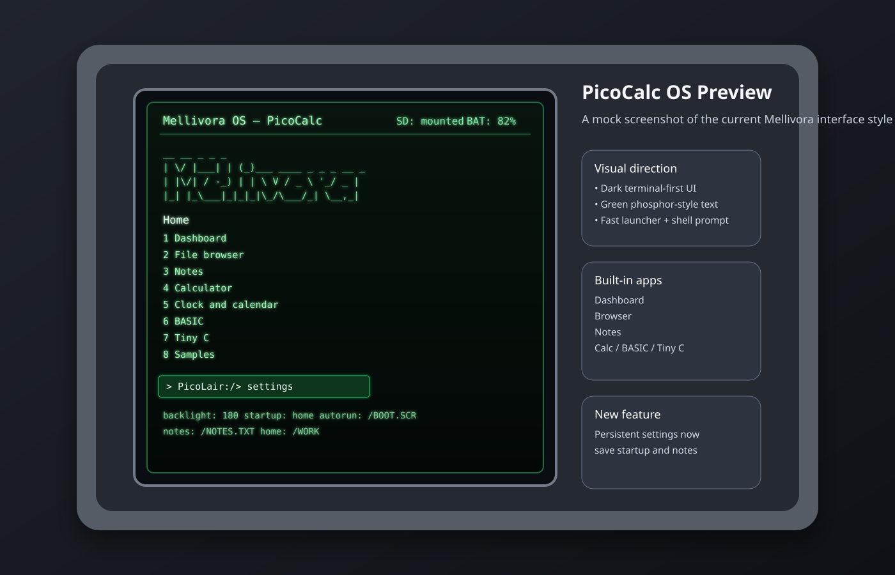

# Mellivora PicoCalc

Mellivora PicoCalc is a compact, keyboard-driven firmware environment for
the Clockwork PicoCalc. It runs on Raspberry Pi Pico (RP2040), Pico 2
(RP2350), and Pico 2 W (RP2350 with CYW43439 Wi-Fi).



The firmware combines a shell, FAT-backed microSD storage, productivity
apps, text and file utilities, small programming environments, creative
tools, and games in a single UF2 image.

## Features

- Shell history, aliases, variables, tab completion, command chaining,
  redirection, pipelines, wildcards, scripts, and built-in help
- FAT16/FAT32 storage, VFAT long-name lookup, recursive file operations,
  file browsing, editing, and hex inspection
- Notes, todo lists, planner, journal, habits, bookmarks, and settings
- Directory-based user-data backup/restore, planner text import/export, and
  read-only SD diagnostics
- Text processing tools, calculator, BASIC, Tiny C, and Forth
- Paint, sprite editor, games, launcher, dashboard, and system monitor
- Pico 2 W networking: Wi-Fi, DNS, NTP, HTTP, certificate-verified HTTPS,
  IRC, and telnet
- Themeable display, persistent clock and working directory, idle dimming,
  low-battery warnings, and watchdog recovery

Wi-Fi support is available only in the Pico 2 W firmware. Saved Wi-Fi
credentials are stored as readable text on the SD card; protect the card
accordingly.

## Quick start

### Flash a release image

The checked-in firmware images are from release v2.5.0:

| Board | Firmware image |
| --- | --- |
| Pico (RP2040) | [`firmware/mellivora_v2.5.0_pico.uf2`](firmware/mellivora_v2.5.0_pico.uf2) |
| Pico 2 (RP2350) | [`firmware/mellivora_v2.5.0_pico2.uf2`](firmware/mellivora_v2.5.0_pico2.uf2) |
| Pico 2 W (RP2350 + Wi-Fi) | [`firmware/mellivora_v2.5.0_pico2w.uf2`](firmware/mellivora_v2.5.0_pico2w.uf2) |

1. Disconnect the PicoCalc from USB.
2. Hold **BOOTSEL** while reconnecting the USB cable.
3. Release **BOOTSEL** when the board's mass-storage drive appears.
4. Copy the matching UF2 to the drive and wait for the board to reboot.
5. Insert a FAT16- or FAT32-formatted microSD card and run `mount`.

Use the image that matches the installed board. Newer prebuilt images may
be available from [GitHub Releases](https://github.com/James-HoneyBadger/Mellivora_OS_PicoCalc/releases).

### Build from source

From the repository root:

```bash
make picocalc   # Pico (RP2040)
make pico2      # Pico 2 (RP2350)
make pico2w     # Pico 2 W (RP2350 + Wi-Fi)
```

The first build fetches the pinned Pico SDK and required submodules unless
`PICO_SDK_PATH` is set to an external SDK checkout. Build prerequisites,
outputs, host tests, and troubleshooting are covered in
[docs/INSTALL.md](docs/INSTALL.md).

## Documentation

| Guide | Contents |
| --- | --- |
| [Quick start](docs/INSTRUCTIONS.md) | Flash and first commands |
| [Installation and development setup](docs/INSTALL.md) | Dependencies, build, storage, and troubleshooting |
| [User guide](docs/USER_GUIDE.md) | Shell, apps, languages, and networking |
| [Tutorial](docs/TUTORIAL.md) | Guided first session |
| [Quick reference](docs/QUICK_REFERENCE.md) | Keyboard shortcuts and command summaries |
| [Command reference](docs/COMMANDS.md) | Categorized command details |
| [Architecture](docs/ARCHITECTURE.md) | Boot flow, modules, and subsystem pipelines |
| [Technical reference](docs/TECHNICAL_REFERENCE.md) | Runtime behavior, persistence, and resource limits |
| [Hardware reference](docs/HARDWARE.md) | Board variants, pin map, and interfaces |
| [Programmer's guide](docs/PROGRAMMING_GUIDE.md) | Source layout, development, and testing |
| [Contributing](docs/CONTRIBUTING.md) | Style, quality gates, and pull request checklist |
| [Feature ideas](docs/FEATURE_IDEAS.md) | Candidate enhancements, not a committed roadmap |
| [Changelog](docs/CHANGELOG.md) | Release history |
| [Security policy](SECURITY.md) | Supported versions and private vulnerability reporting |

## Project layout

- `picocalc/src/` — firmware, apps, hardware drivers, and portable core logic
- `picocalc/tests/` — host-side tests, including FAT tests with a simulated SD card
- `docs/` — user, developer, hardware, and architecture documentation
- `tools/` — command-documentation and quality-check scripts
- `firmware/` — checked-in v2.5.0 UF2 images
- `VERSION`, `REPOSITORY` — canonical firmware and repository metadata

Three build targets are maintained from the same source tree: `picocalc`,
`pico2`, and `pico2w`. CI builds the firmware variants and publishes
SHA-256 checksums with release images.

## License

See [LICENSE](LICENSE).
